# PROJECT_ARCHITECTURE_FOR_ARTICLE

## 1. Краткое назначение проекта

Репозиторий содержит проект `servo_diagnostic_model` — интерпретируемую физико-статистическую модель диагностики телеметрии сервопривода. Лабораторный стенд построен на сервоприводе Delta `ASD-B3-0421-E` и двигателе `ECM-B3M-CA0604RS1`; связь со стендом указана как EtherCAT (CoE), режим управления — Profile Position.

Проект анализирует временные окна телеметрии: положение, скорость, ток, момент, напряжение DC-шины, температуру привода, CiA 402 `statusword`, `error_code`, режим и метаданные эксперимента. Для каждого окна формируются инженерные признаки, физические риски, статистическое отклонение от нормального median/MAD-профиля, Health Score, класс состояния, причины, объяснения и детерминированные рекомендации.

Фактически реализованные контуры:

- **Лабораторный/edge-контур:** сбор выполнен внешним ПО `servo-app/lab-0.1`; его исходного кода в репозитории нет. В репозитории находятся экспортированные CSV и архив этих CSV.
- **Data/AI-контур:** загрузка, нормализация, валидация, оконная обработка, признаки, физические риски, median/MAD anomaly detection, Health Score и классификация.
- **Evaluation-контур:** формирование профилей, holdout-проверка, калибровочный sweep порога, диагностические JSON/CSV, графики и отчёты для статьи.
- **Backend/frontend:** документация предусматривает интеграцию с backend/PWA, но фактического backend-сервера и frontend-кода в репозитории нет.

Готовые ML-фреймворки не применяются. Статистическая часть реализована вручную на основе median, MAD, стандартного отклонения и взвешивания признаков.

## 2. Текущее состояние репозитория

- Текущая ветка: `main`.
- Последний commit: `bfa35abe06bc2b5d9a4fc5d8665b8b8a6511f2d9`.
- Сообщение commit: `Regenerate article figures after threshold calibration`.
- Незакоммиченные пользовательские/исходные изменения до анализа:
  - `?? Plan.docx`
  - `?? artifacts/article_figures/normal_health_outlier_report.md`
- После разрешённого запуска тестов Python обновил два отслеживаемых файла `__pycache__`; это технический побочный эффект запуска, не изменение исходного кода.
- Тестовый набор: 14 файлов `tests/test_*.py`, 205 тестов.
- Команда запуска: `.\.venv\Scripts\python.exe -m pytest -q -p no:cacheprovider`.
- Последний корректный результат: **205 passed in 9.84s**.
- Первый запуск в ограниченной песочнице дал `153 passed, 52 errors` только из-за отсутствия доступа pytest к системному `%TEMP%`; после запуска с доступом к `%TEMP%` все тесты прошли.

Важные сгенерированные артефакты:

- `artifacts/profiles/normal_profile_lab.json` — профиль по 17 нормальным файлам и 2 406 окнам.
- `artifacts/diagnostics/lab_diagnostic_results.json` — полные оконные результаты по тестовым сессиям.
- `artifacts/validation_after_threshold_calibration/` — holdout-валидация после применения порога.
- `artifacts/calibration_after_threshold_application/` — sweep и отчёт калибровки.
- `artifacts/article_figures_after_threshold_calibration/` — наиболее актуальный комплект из шести рисунков и отчёта.
- `data/lab/raw/telemetry.zip` — архив 37 CSV; SQLite-файлов внутри архива нет.

В корне отсутствуют `README.md`, `pyproject.toml`, `requirements.txt`, `.env.example`, `main.py`, backend- и frontend-конфиги.

## 3. Полное дерево файлов проекта

Технический мусор (`.git`, `.venv`, `__pycache__`, `.pytest_cache`) исключён. Для повторяющихся наборов данных и артефактов сохранены все имена файлов.

```text
.
├── .agents/
│   └── skills/
│       ├── servo-config-driven-model/SKILL.md
│       ├── servo-data-pipeline/SKILL.md
│       ├── servo-feature-engineering/SKILL.md
│       ├── servo-health-classifier/SKILL.md
│       ├── servo-implementation-planner/SKILL.md
│       ├── servo-json-contract/SKILL.md
│       ├── servo-no-ml-libraries/SKILL.md
│       ├── servo-physical-risk-model/SKILL.md
│       ├── servo-project-context/SKILL.md
│       ├── servo-python-architecture/SKILL.md
│       ├── servo-recommendations/SKILL.md
│       ├── servo-statistical-anomaly/SKILL.md
│       └── servo-testing-evaluation/SKILL.md
├── artifacts/
│   ├── article_figures/
│   │   ├── README.md
│   │   ├── results_report.md
│   │   ├── normal_health_outlier_report.md
│   │   ├── fig1_group_anomaly_with_normal.png
│   │   ├── fig2_group_health_with_normal.png
│   │   ├── fig3_e2_r02_scores_over_time.png
│   │   ├── fig4_e2_r02_risks_over_time.png
│   │   ├── fig5_statistical_vs_physical_risks.png
│   │   └── fig6_e2_r02_current_torque.png
│   ├── article_figures_after_temperature_fix/
│   │   ├── README.md
│   │   ├── results_report.md
│   │   ├── fig1_group_anomaly_with_normal.png
│   │   ├── fig2_group_health_with_normal.png
│   │   ├── fig3_e2_r02_scores_over_time.png
│   │   ├── fig4_e2_r02_risks_over_time.png
│   │   ├── fig5_statistical_vs_physical_risks.png
│   │   └── fig6_e2_r02_current_torque.png
│   ├── article_figures_after_threshold_calibration/
│   │   ├── README.md
│   │   ├── results_report.md
│   │   ├── fig1_group_anomaly_with_normal.png
│   │   ├── fig2_group_health_with_normal.png
│   │   ├── fig3_e2_r02_scores_over_time.png
│   │   ├── fig4_e2_r02_risks_over_time.png
│   │   ├── fig5_statistical_vs_physical_risks.png
│   │   └── fig6_e2_r02_current_torque.png
│   ├── calibration/
│   │   ├── anomaly_threshold_sweep.csv
│   │   ├── anomaly_threshold_sweep.json
│   │   ├── calibration_recommendation.json
│   │   ├── calibration_report.md
│   │   ├── e2_r02_top_anomaly_features.csv
│   │   ├── group_separation_summary.csv
│   │   └── normal_false_positive_features.csv
│   ├── calibration_after_threshold_application/
│   │   ├── anomaly_threshold_sweep.csv
│   │   ├── anomaly_threshold_sweep.json
│   │   ├── calibration_recommendation.json
│   │   ├── calibration_report.md
│   │   ├── e2_r02_top_anomaly_features.csv
│   │   ├── group_separation_summary.csv
│   │   └── normal_false_positive_features.csv
│   ├── diagnostics/
│   │   ├── lab_diagnostic_results.json
│   │   ├── lab_diagnostic_summary.csv
│   │   ├── lab_pipeline_analysis.md
│   │   ├── temperature_risk_fix_comparison.md
│   │   ├── temperature_risk_fix_diagnostic_results.json
│   │   ├── temperature_risk_fix_diagnostic_summary.csv
│   │   └── threshold_calibration_application_report.md
│   ├── plots/
│   │   ├── data_quality_cases.png
│   │   ├── e2_r02_current_torque_over_time.png
│   │   ├── e2_r02_risks_over_time.png
│   │   ├── e2_r02_scores_over_time.png
│   │   ├── group_anomaly_comparison.png
│   │   ├── group_health_comparison.png
│   │   ├── statistical_vs_physical_risks.png
│   │   └── plots_summary.md
│   ├── profiles/
│   │   └── normal_profile_lab.json
│   ├── validation/
│   │   ├── holdout_validation_report.md
│   │   ├── normal_holdout_diagnostic_results.json
│   │   ├── normal_holdout_summary.csv
│   │   ├── normal_profile_holdout_train.json
│   │   ├── test_with_holdout_profile_results.json
│   │   └── test_with_holdout_profile_summary.csv
│   └── validation_after_threshold_calibration/
│       ├── holdout_validation_report.md
│       ├── normal_holdout_diagnostic_results.json
│       ├── normal_holdout_summary.csv
│       ├── normal_profile_holdout_train.json
│       ├── test_with_holdout_profile_results.json
│       └── test_with_holdout_profile_summary.csv
├── data/lab/
│   ├── exports/
│   │   ├── telemetry_A1_HOLDING_SERVO_ON_R01_20260611_141919.csv
│   │   ├── telemetry_A1_HOLDING_SERVO_ON_R02_20260611_172739.csv
│   │   ├── telemetry_A2_HOLD_AFTER_MOVE_R01_20260611_142122.csv
│   │   ├── telemetry_A2_HOLD_AFTER_MOVE_R02_20260611_172458.csv
│   │   ├── telemetry_A3_ROTATE_ONE_DIR_R01_20260611_142325.csv
│   │   ├── telemetry_A3_ROTATE_ONE_DIR_R02_20260611_172320.csv
│   │   ├── telemetry_A4_ROTATE_BOTH_DIRS_R01_20260611_142458.csv
│   │   ├── telemetry_A4_ROTATE_BOTH_DIRS_R02_20260611_172103.csv
│   │   ├── telemetry_B1_ACC_DEC_SLOW_R01_20260611_155606.csv
│   │   ├── telemetry_B2_ACC_DEC_MEDIUM_R01_20260611_155746.csv
│   │   ├── telemetry_B2_ACC_DEC_MEDIUM_R02_20260611_171101.csv
│   │   ├── telemetry_B3_ACC_DEC_SHARP_R01_20260611_155927.csv
│   │   ├── telemetry_B3_ACC_DEC_SHARP_R02_20260611_171240.csv
│   │   ├── telemetry_B4_REVERSAL_R01_20260611_143109.csv
│   │   ├── telemetry_B4_REVERSAL_R02_20260611_171416.csv
│   │   ├── telemetry_B5_CYCLIC_R01_20260611_143242.csv
│   │   ├── telemetry_B5_CYCLIC_R02_20260611_171553.csv
│   │   ├── telemetry_C1_SPEED_300_R01_20260611_143748.csv
│   │   ├── telemetry_C1_SPEED_300_R02_20260611_170335.csv
│   │   ├── telemetry_C2_SPEED_600_R01_20260611_143856.csv
│   │   ├── telemetry_C2_SPEED_600_R02_20260611_170453.csv
│   │   ├── telemetry_C3_SPEED_900_R01_20260611_144003.csv
│   │   ├── telemetry_C3_SPEED_900_R02_20260611_170559.csv
│   │   ├── telemetry_C4_SPEED_1200_R01_20260611_144110.csv
│   │   ├── telemetry_C4_SPEED_1200_R02_20260611_170706.csv
│   │   ├── telemetry_C5_SPEED_1500_R01_20260611_144217.csv
│   │   ├── telemetry_C5_SPEED_1500_R02_20260611_170849.csv
│   │   ├── telemetry_D1_LONG_CYCLE_LOW_R01_20260611_144324.csv
│   │   ├── telemetry_D1_LONG_CYCLE_LOW_R02_20260611_172952.csv
│   │   ├── telemetry_D2_LONG_CYCLE_MED_R01_20260611_145332.csv
│   │   ├── telemetry_D2_LONG_CYCLE_MED_R02_20260611_174000.csv
│   │   ├── telemetry_D3_LONG_CYCLE_HARD_R01_20260611_150338.csv
│   │   ├── telemetry_D3_LONG_CYCLE_HARD_R02_20260611_175010.csv
│   │   ├── telemetry_E1_LOAD_LOW_INERTIA_R01_20260611_163136.csv
│   │   ├── telemetry_E1_LOAD_LOW_INERTIA_R02_20260611_165448.csv
│   │   ├── telemetry_E2_LOAD_MED_INERTIA_R01_20260611_163848.csv
│   │   └── telemetry_E2_LOAD_MED_INERTIA_R02_20260611_165930.csv
│   ├── manifests/
│   │   ├── excluded_files.csv
│   │   ├── normal_profile_files.csv
│   │   ├── normal_train_files.csv
│   │   ├── normal_validation_files.csv
│   │   └── test_files.csv
│   ├── metadata/
│   │   ├── experiments.csv
│   │   ├── lab_notes.md
│   │   └── stand_passport.csv
│   └── raw/telemetry.zip
├── markdowns/
│   ├── 00_PROJECT_OVERVIEW.md
│   ├── 01_DOMAIN_CONTEXT.md
│   ├── 02_TELEMETRY_SCHEMA.md
│   ├── 03_MODEL_REQUIREMENTS.md
│   ├── 04_CODE_ARCHITECTURE.md
│   ├── 05_DATA_PIPELINE.md
│   ├── 06_FEATURE_ENGINEERING.md
│   ├── 07_PHYSICAL_RISK_MODEL.md
│   ├── 08_STATISTICAL_ANOMALY_MODEL.md
│   ├── 09_HEALTH_SCORE_AND_CLASSIFIER.md
│   ├── 10_RECOMMENDATION_MODULE.md
│   ├── 11_CONFIGS_AND_CONSTANTS.md
│   ├── 12_TESTING_AND_EVALUATION.md
│   ├── 13_IMPLEMENTATION_ROADMAP.md
│   ├── 14_CODING_AGENT_PROMPT.md
│   └── 15_CURRENT_PROJECT_STATE.md
├── servo_diagnostic_model/
│   ├── __init__.py
│   ├── api/
│   │   ├── __init__.py
│   │   ├── diagnostic_service.py
│   │   ├── profile_service.py
│   │   └── schemas.py
│   ├── config/
│   │   ├── __init__.py
│   │   ├── limits.json
│   │   ├── thresholds.json
│   │   └── weights.json
│   ├── data/
│   │   ├── __init__.py
│   │   ├── loader.py
│   │   ├── preprocessing.py
│   │   ├── schemas.py
│   │   ├── validator.py
│   │   └── windowing.py
│   ├── evaluation/
│   │   ├── __init__.py
│   │   ├── article_plots.py
│   │   ├── calibration.py
│   │   ├── lab_calibration.py
│   │   ├── lab_plots.py
│   │   ├── lab_validation.py
│   │   ├── plots.py
│   │   └── validation.py
│   ├── features/
│   │   ├── __init__.py
│   │   ├── basic_features.py
│   │   ├── electrical_features.py
│   │   ├── feature_extractor.py
│   │   ├── motion_features.py
│   │   ├── status_features.py
│   │   └── thermal_features.py
│   ├── model/
│   │   ├── __init__.py
│   │   ├── anomaly_score.py
│   │   ├── classifier.py
│   │   ├── explanation.py
│   │   ├── health_score.py
│   │   ├── physical_risks.py
│   │   └── statistical_profile.py
│   └── recommendations/
│       ├── __init__.py
│       └── rule_based.py
├── tests/
│   ├── test_article_plots.py
│   ├── test_calibration.py
│   ├── test_diagnostic_service.py
│   ├── test_features.py
│   ├── test_health_classifier.py
│   ├── test_loader.py
│   ├── test_physical_risks.py
│   ├── test_plots.py
│   ├── test_preprocessing.py
│   ├── test_profile_service.py
│   ├── test_recommendations.py
│   ├── test_statistical_anomaly.py
│   ├── test_validation.py
│   └── test_windowing.py
├── .gitignore
├── AGENTS.md
├── Plan.docx
└── PROJECT_ARCHITECTURE_FOR_ARTICLE.md
```

## 4. Таблица всех значимых файлов

| Путь | Тип файла | Назначение | Важность для статьи |
| ---- | --------- | ---------- | ------------------- |
| `data/lab/exports/telemetry_*.csv` | CSV, 37 файлов | Лабораторная телеметрия нормальных, переходных и нагрузочных режимов | обязательно |
| `data/lab/metadata/experiments.csv` | CSV | Реестр 37 сессий, режимы, метки риска, длительности и команды | обязательно |
| `data/lab/metadata/stand_passport.csv` | CSV | Паспорт стенда, привод, двигатель, номиналы, EtherCAT/CoE | обязательно |
| `data/lab/metadata/lab_notes.md` | Markdown | Описание групп A–E, допущений и ограничений датасета | обязательно |
| `data/lab/manifests/normal_profile_files.csv` | CSV | 17 нормальных файлов для основного профиля | обязательно |
| `data/lab/manifests/normal_train_files.csv` | CSV | 9 файлов train для holdout-профиля | обязательно |
| `data/lab/manifests/normal_validation_files.csv` | CSV | 8 нормальных файлов holdout | обязательно |
| `data/lab/manifests/test_files.csv` | CSV | 20 тестовых файлов | обязательно |
| `data/lab/manifests/excluded_files.csv` | CSV | Обоснование исключения ненормальных файлов из профиля | желательно |
| `data/lab/raw/telemetry.zip` | ZIP | Архив всех 37 CSV | желательно |
| `servo_diagnostic_model/api/diagnostic_service.py` | Python | Главный оркестратор диагностики и JSON-контракт | обязательно |
| `servo_diagnostic_model/api/profile_service.py` | Python | Построение нормального профиля из CSV/манифестов | обязательно |
| `servo_diagnostic_model/data/*.py` | Python | Загрузка CSV, нормализация, валидация и окна | обязательно |
| `servo_diagnostic_model/features/*.py` | Python | Инженерные признаки телеметрии | обязательно |
| `servo_diagnostic_model/model/physical_risks.py` | Python | Физические риски и data-quality risk | обязательно |
| `servo_diagnostic_model/model/statistical_profile.py` | Python | Median/MAD-профиль нормы | обязательно |
| `servo_diagnostic_model/model/anomaly_score.py` | Python | Robust anomaly score | обязательно |
| `servo_diagnostic_model/model/health_score.py` | Python | Взвешенный Health Score и hard caps | обязательно |
| `servo_diagnostic_model/model/classifier.py` | Python | Пороговая классификация состояния | обязательно |
| `servo_diagnostic_model/model/explanation.py` | Python | Главные причины и объяснения | желательно |
| `servo_diagnostic_model/recommendations/rule_based.py` | Python | Детерминированные рекомендации | желательно |
| `servo_diagnostic_model/config/limits.json` | JSON | Физические пределы и пороги качества | обязательно |
| `servo_diagnostic_model/config/weights.json` | JSON | Веса рисков в Health Score | обязательно |
| `servo_diagnostic_model/config/thresholds.json` | JSON | Окна и пороги классификации/anomaly | обязательно |
| `servo_diagnostic_model/evaluation/validation.py` | Python | Holdout split и метрики | обязательно |
| `servo_diagnostic_model/evaluation/calibration.py` | Python | Sweep anomaly-порога и анализ FP | обязательно |
| `servo_diagnostic_model/evaluation/plots.py` | Python | Базовые воспроизводимые графики | обязательно |
| `servo_diagnostic_model/evaluation/article_plots.py` | Python | Финальный комплект графиков статьи | обязательно |
| `artifacts/profiles/normal_profile_lab.json` | JSON | Основной обученный профиль нормы | обязательно |
| `artifacts/validation_after_threshold_calibration/*` | JSON/CSV/MD | Актуальная same-campaign holdout-проверка | обязательно |
| `artifacts/calibration_after_threshold_application/*` | JSON/CSV/MD | Обоснование порога `anomaly_warning=0.62` | обязательно |
| `artifacts/article_figures_after_threshold_calibration/*` | PNG/MD | Финальные рисунки и численные результаты | обязательно |
| `artifacts/diagnostics/lab_pipeline_analysis.md` | Markdown | Анализ полного лабораторного pipeline | обязательно |
| `artifacts/diagnostics/temperature_risk_fix_comparison.md` | Markdown | Документирование исправления ложного thermal outlier | желательно |
| `tests/test_*.py` | Python/pytest | Проверка формул, контрактов, графиков и evaluation | желательно |
| `markdowns/00_PROJECT_OVERVIEW.md` ... `13_IMPLEMENTATION_ROADMAP.md` | Markdown | Исходная постановка, архитектура и формулы | желательно |
| `markdowns/15_CURRENT_PROJECT_STATE.md` | Markdown | Исторический снимок, частично устарел | необязательно |
| `.agents/skills/*` | Markdown | Инструкции coding agent | технический |
| `.gitignore`, `AGENTS.md` | Конфиг/Markdown | Правила репозитория | технический |
| `Plan.docx` | DOCX | Неотслеживаемый план; содержание не использовалось как источник формул | необязательно |

## 5. Архитектура проекта

Основной фактический поток:

1. Внешнее ПО `servo-app/lab-0.1` получает телеметрию Delta ASDA-B3 по EtherCAT/CoE.
2. Сессии экспортируются в CSV; метаданные и split фиксируются отдельными CSV-манифестами.
3. `data.loader` и `data.preprocessing` читают CSV, нормализуют имена, время и числовые поля.
4. `data.validator` формирует ошибки и предупреждения качества.
5. `data.windowing` создаёт перекрывающиеся окна 5 с с шагом 1 с.
6. `features.feature_extractor` объединяет признаки движения, тока, момента, напряжения, температуры, CiA 402 и качества.
7. `model.physical_risks` сравнивает признаки с `limits.json`.
8. При наличии профиля `model.anomaly_score` сравнивает признаки с median/MAD-профилем.
9. `health_score`, `classifier`, `explanation` и `recommendations` формируют JSON-совместимый результат.
10. Evaluation-модули строят профили, holdout-результаты, калибровочные таблицы, PNG и Markdown-отчёты.

```mermaid
flowchart LR
    Drive["Delta ASDA-B3 + motor"] -->|"EtherCAT / CoE"| Collector["External servo-app/lab-0.1"]
    Collector --> CSV["data/lab/exports/*.csv"]
    CSV --> Prep["loader + preprocessing + validator"]
    Prep --> Windows["5 s windows, 1 s step"]
    Windows --> Features["feature_extractor"]
    Features --> Physical["physical_risks + limits.json"]
    Features --> Statistical["median/MAD profile + anomaly_score"]
    Physical --> Orchestrator["api/diagnostic_service.py"]
    Statistical --> Orchestrator
    Orchestrator --> Result["JSON-compatible diagnostic result"]
    Result --> Evaluation["validation + calibration + plots"]
    Evaluation --> Artifacts["reports, JSON, CSV, PNG"]
    Artifacts -.-> Article["Scientific article materials"]
```



Интерфейсы между частями: CSV и манифесты на входе; dataclass-объекты `TelemetrySample`, `TelemetryDataset`, `TelemetryWindow` внутри data pipeline; словари признаков/рисков; JSON-совместимый `DiagnosticResult` на выходе. Сетевого API, базы данных и UI в текущем репозитории нет.

## 6. Данные и телеметрия

### Общая характеристика

- CSV-сессий: **37**.
- Суммарно строк: **67 219**.
- Суммарная длительность: **6 749,876 с**, или **112,5 мин**.
- Фактическая частота: приблизительно **9,92–9,97 Гц**.
- Все CSV имеют общую схему из 32 колонок:

```text
ts,t,experiment_id,session_id,device_id,statusword,statusword_flags,mode_display,
error_code,position,velocity,current,current_A,torque,torque_Nm,dc_bus_voltage,
drive_temp,rated_current,rated_torque,max_motor_speed,target_position,
target_velocity,target_torque,acceleration_cmd,deceleration_cmd,regime_label,
risk_label,is_artificial_anomaly,load_type,direction,operator_comment,software_version
```

Пример первых трёх записей E2 R02, сокращённый до ключевых колонок:

| t, с | statusword | mode | error_code | velocity | current_A | torque_Nm | DC bus, V | temp, °C | risk_label |
| ---: | ---------: | ---: | ---------: | -------: | --------: | --------: | --------: | -------: | ---------- |
| 0.000 | 567 | 3 | 0 | 496 | 1.10166 | 0.626442 | 307 | 47 | pre_emergency_proxy |
| 0.100 | 1591 | 3 | 0 | 621 | -0.31171 | -0.186498 | 307 | 47 | pre_emergency_proxy |
| 0.201 | 1591 | 3 | 0 | 614 | 0.00854 | 0.009564 | 308 | 47 | pre_emergency_proxy |

### Статистика по CSV

| Группа/файлы | Количество файлов | Строки на файл | Длительность на файл | Частота |
| ------------ | ----------------: | -------------: | --------------------: | ------: |
| A1/A2 holding | 4 | 1 188–1 197 | 119,87–119,97 с | 9,90–9,97 Гц |
| A3/A4 low-speed/reversal | 4 | 894–898 | 89,96–89,99 с | 9,93–9,97 Гц |
| B1–B4 acc/dec/reversal | 7 | 894–898 | 89,91–90,04 с | 9,92–9,97 Гц |
| B5 cyclic | 2 | 2 979–2 992 | 299,98–300,06 с | 9,93–9,97 Гц |
| C1–C5 speed | 10 | 596–600 | 59,96–60,08 с | 9,92–9,97 Гц |
| D1–D3 long cycle | 6 | 5 957–5 982 | 599,99–600,06 с | 9,93–9,97 Гц |
| E1/E2 load | 4 | 1 196–1 199 | 120,05–120,18 с | 9,95–9,97 Гц |

Точные пути всех CSV перечислены в полном дереве. Длительность вычислена как `last(t) - first(t)`, частота — `(N-1)/duration`; код проекта использует более устойчивую оценку `1 / median(positive_delta_t)`.

### Манифесты и splits

- `normal_profile_files.csv`: 17 нормальных файлов.
- `normal_train_files.csv`: 9 файлов.
- `normal_validation_files.csv`: 8 файлов.
- `test_files.csv`: 20 файлов.
- `excluded_files.csv`: 20 файлов, исключённых из normal profile, но сохранённых для тестирования.
- `experiments.csv`: 37 строк; normal — 17, transition — 12, elevated_load — 6, pre_emergency_proxy — 2.

### SQLite и JSON

В документации и `experiments.csv` исходные сессии названы `.sqlite3`, однако фактических SQLite-файлов в репозитории и в `telemetry.zip` нет. Поэтому таблицы, SQLite-схема и записи базы не могут быть проверены. Архив содержит только 37 CSV.

JSON используется для конфигураций, нормальных профилей, диагностических результатов, holdout-результатов и калибровочных sweep. Крупнейшие результаты: `lab_diagnostic_results.json` около 28 МБ и `test_with_holdout_profile_results.json` около 27 МБ.

## 7. Модель диагностики и расчёта состояния

| Элемент | Файл, функция/класс | Логика | Вход → выход |
| ------- | ------------------- | ------ | ------------ |
| Нормализация колонок/времени | `data/preprocessing.py`: `normalize_column_names`, `parse_time_columns`, `coerce_numeric_columns` | Алиасы приводятся к каноническим именам; `t` выводится из `ts`; пропуски не заменяются нулём | DataFrame → нормализованный DataFrame |
| Валидация | `data/validator.py`: `validate_dataframe` | Требуется время, ненулевая длительность и не менее 3 диагностических каналов; пропуски дают warnings | DataFrame → errors/warnings |
| Окна | `data/windowing.py`: `make_windows` | Полуоткрытые перекрывающиеся окна; по конфигу 5 с, шаг 1 с, минимум 10 точек | samples → `TelemetryWindow[]` |
| Признаки | `features/feature_extractor.py`: `extract_features` | Объединяет motion/electrical/thermal/status/data-quality признаки | окно → словарь признаков |
| CiA 402 | `features/status_features.py`: `decode_statusword`, `calculate_status_features` | Биты `0x0001`, `0x0002`, `0x0004`, `0x0008`, `0x0010`, `0x0080`; ненулевой `error_code` → `error_flag` | statusword/error_code → флаги и counts |
| Физические риски | `model/physical_risks.py`: `calculate_physical_risks` | Максимум компонентных рисков; все значения clamped 0..1 | features + limits → risks |
| Ток/момент/скорость | `calculate_current_risk`, `calculate_torque_risk`, `calculate_velocity_risk` | `risk = clamp(abs(feature)/limit)`; для тока/момента максимум RMS, peak и low-speed | признаки + пределы → 0..1 |
| Напряжение | `calculate_voltage_risk` | Максимум low-voltage inverse-linear, high-voltage linear и `voltage_std/limit` | voltage features → 0..1 |
| Температура | `calculate_temperature_risk` | Максимум риска уровня и положительного slope; slope ограничивается caps при температуре ниже safe | temp features → 0..1 |
| Ошибка/statusword | `calculate_error_risk`, `calculate_statusword_risk` | `error_flag` или fault → 1; warning → 0.6; недоступный statusword → 0.3 | flags → 0..1 |
| Data quality | `calculate_data_quality_risk` | Максимум missing/invalid/time gaps/short/missing critical groups | quality features → 0..1 |
| Нормальный профиль | `model/statistical_profile.py`: `fit_normal_profile` | Для глобального и фазовых профилей: median, MAD, mean, std, min, max, count | normal feature rows → JSON profile |
| Anomaly Score | `model/anomaly_score.py`: `calculate_anomaly_score` | `feature_score=clamp(|x-median|/scale/z_limit)`; итог `0.7*weighted_mean + 0.3*max` | features + profile → score 0..1 |
| Health Score | `model/health_score.py`: `calculate_health_score` | `100*(1 - sum(w_i*r_i)/sum(w_i))`, затем clamp 0..100 и hard caps | risks + weights → 0..100 |
| Hard limits | `apply_hard_limits` | error/fault/statusword critical → max 40; critical temp/voltage → max 50; bad data → max 60 | score + risks/features → capped score |
| Классификатор | `model/classifier.py`: `classify_state` | Приоритет: unknown → error/fault critical → health/anomaly/physical thresholds | score + risks + thresholds → state |
| Оркестратор | `api/diagnostic_service.py`: `diagnose_window`, `diagnose_csv` | Последовательно вызывает все блоки и формирует JSON-контракт | CSV/окно → diagnostic result |

Основные пороги состояния:

- Health Score: normal `>=85`, observation `70..85`, warning `50..70`, critical `<50`.
- Anomaly Score: observation `>=0.30`, warning `>=0.62`, critical `>=0.75`.
- Физические риски: observation `>=0.50`, warning `>=0.75`, critical `>=0.90`.
- `error_flag=True`, `fault_flag=True`, `error risk=1` или `statusword risk=1` всегда дают `critical`.

## 8. Экспериментальные сценарии

| Сценарий | Путь к данным | Назначение | Какие признаки должны изменяться | Как используется в оценке |
| -------- | ------------- | ---------- | -------------------------------- | ------------------------- |
| A1/A2 holding | `telemetry_A1*`, `telemetry_A2*` | Нормальный baseline удержания | низкая скорость, малые ток/момент, стабильная температура | normal profile/holdout |
| A3/A4 | `telemetry_A3*`, `telemetry_A4*` | Нормальное низкоскоростное движение и реверс | velocity/position, переходные accel | normal profile/holdout |
| B1 | `telemetry_B1*` | Медленное нормальное ускорение/торможение | accel, velocity | normal profile |
| B2/B4/B5 | соответствующие `telemetry_B*` | Переходные режимы | accel, reversal, position/velocity variability | test: `transition` |
| B3 | `telemetry_B3*` | Резкое, но разрешённое acc/dec | accel, current, torque | test: `elevated_load` |
| C1–C3 | `telemetry_C1*` ... `C3*` | Нормальные постоянные скорости 300–900 rpm | уровни velocity и связанные признаки | normal profile/holdout |
| C4/C5 | `telemetry_C4*`, `C5*` | Более высокие скорости 1200/1500 rpm | velocity и статистические отклонения | test: `transition` |
| D1 | `telemetry_D1*` | Длинный нормальный цикл | циклические motion/thermal признаки | normal profile/holdout |
| D2 | `telemetry_D2*` | Длинный переходный цикл | motion variability, thermal trend | test: `transition` |
| D3 | `telemetry_D3*` | Длинный hard cycle | accel/current/torque/thermal | test: `elevated_load` |
| E1 | `telemetry_E1*` | Контролируемая малая инерционная нагрузка | current/torque и статистические признаки | test: `elevated_load` |
| E2 | `telemetry_E2*` | Средняя инерция, **предаварийный прокси** | прежде всего statistical deviation, current/torque | главный case study |

Искусственные аномалии в данных отсутствуют: `is_artificial_anomaly=0`. Модуль генерации synthetic anomalies, описанный в документации, не реализован. E2 нельзя называть подтверждённой аварией или подтверждённым предсказанием отказа. Независимой валидации на отдельной кампании нет; текущая holdout-проверка разделяет повторы той же лабораторной кампании.

## 9. Графики и материалы для статьи

Код построения находится в:

- `servo_diagnostic_model/evaluation/plots.py`
- `servo_diagnostic_model/evaluation/article_plots.py`
- CLI wrappers: `lab_plots.py`

PNG сохраняются с `dpi=300`, `bbox_inches="tight"`, белым фоном. Наиболее актуальная папка: `artifacts/article_figures_after_threshold_calibration/`.

| Рисунок | Файл | Что показывает | Почему важен для статьи |
| ------- | ---- | -------------- | ----------------------- |
| Fig. 1 | `fig1_group_anomaly_with_normal.png` | Mean и maximum Anomaly Score по normal/transition/elevated/pre-emergency | Главная демонстрация разделения групп |
| Fig. 2 | `fig2_group_health_with_normal.png` | Mean и minimum Health Score по группам | Показывает, что Health Score остаётся высоким при низких физических рисках |
| Fig. 3 | `fig3_e2_r02_scores_over_time.png` | Anomaly Score и Health Score E2 R02; нанесён warning threshold 0.62 | Временная динамика главного case study |
| Fig. 4 | `fig4_e2_r02_risks_over_time.png` | Statistical anomaly, current, torque, velocity, temperature risks | Показывает доминирование статистического риска |
| Fig. 5 | `fig5_statistical_vs_physical_risks.png` | Средний statistical risk против максимального physical risk | Поддерживает тезис раннего отклонения до hard limits |
| Fig. 6 | `fig6_e2_r02_current_torque.png` | RMS ток и момент E2 R02 с median-линями нормального профиля | Физический контекст статистической аномалии |

Подписи и оси задаются в `plots.py`: `Time, s`, `Anomaly Score`, `Health Score`, `Risk, 0..1`, `Current, A`, `Torque, N·m`. Групповые графики используют фиксированные цвета и diamond-marker для максимумов/минимумов. Fig. 3 содержит горизонтальную линию `anomaly_warning=0.62`; Fig. 6 — median нормального профиля (`current_rms≈0.0795 A`, `torque_rms≈0.0446 N·m`).

Актуальные численные результаты из `results_report.md`:

- normal holdout: 1 161 окно, mean anomaly `0.539`, mean health `94.796`;
- warning-or-higher false-positive rate `7.924%`;
- critical false-positive rate `0.086%`;
- E2 R02: max anomaly `0.858`, mean anomaly `0.801`, detection above 0.62 — `100%`;
- E2 R02 занимает первое место по mean и maximum anomaly среди тестовых сессий.

## 10. Тесты и проверка корректности

| Тестовый файл | Проверяемая область |
| ------------- | ------------------- |
| `test_loader.py`, `test_preprocessing.py`, `test_validation.py`, `test_windowing.py` | CSV pipeline, время, пропуски, окна, holdout workflow |
| `test_features.py` | RMS, slope, motion, current/torque/voltage/temp/statusword |
| `test_physical_risks.py` | Формулы риска, clamp, missing data, temperature gates |
| `test_health_classifier.py` | Health Score, hard caps, state, causes/explanations |
| `test_statistical_anomaly.py` | median/MAD, robust score, phase profile |
| `test_diagnostic_service.py` | End-to-end и JSON-совместимость |
| `test_profile_service.py` | Построение профиля из CSV и манифестов |
| `test_recommendations.py` | Правила рекомендаций |
| `test_plots.py`, `test_article_plots.py` | Создание графиков, линии порогов и normal median |
| `test_calibration.py` | Sweep, выбор кандидата, неизменность production-конфигов |

Особенно значимы для статьи тесты диапазонов рисков и Health Score, принудительного critical по error/fault, формулы median/MAD, построения holdout-профиля, воспроизводимости графиков, пороговой линии 0.62 и запрета изменения production-конфигов калибровочным workflow.

Отдельных snapshot/golden-тестов на точное неизменное численное значение всех формул, всех весов и всех PNG нет. Однако тесты явно проверяют многие формулы, production-конфиги и наличие элементов графиков.

## 11. Конфигурационные файлы

### `servo_diagnostic_model/config/limits.json`

Физические и data-quality пределы. Ключевые значения: rated current `4.27 A`, max current `12.8 A`, rated torque `2.39 N·m`, max torque `8.36 N·m`, max speed `6000 rpm`, DC safe `280..340 V`, DC critical `240..380 V`, temp safe/warning/critical `55/70/85 °C`. Также содержит пороги slope, quantization caps, missing/invalid/time gaps и motion thresholds.

Rated current, rated torque и speed согласованы с `stand_passport.csv`; максимальные ток/момент, DC- и thermal-пределы в паспорте не задокументированы полностью. Это ограничивает строгость физической интерпретации.

### `servo_diagnostic_model/config/weights.json`

Веса Health Score:

```text
error 0.25; temperature 0.18; current 0.16; statusword 0.15;
torque 0.14; voltage 0.14; statistical_anomaly 0.08;
velocity 0.03; data_quality 0.02
```

Сумма весов больше 1, но формула нормализует её через деление на `total_weight`.

### `servo_diagnostic_model/config/thresholds.json`

Окно `5 с`, шаг `1 с`, минимум `10` точек; health thresholds `85/70/50`; anomaly thresholds `0.30/0.62/0.75`; physical risk thresholds `0.50/0.75/0.90`. Порог warning `0.62` выбран после evaluation-only sweep на same-campaign holdout и влияет на результаты статьи.

### Прочие конфиги

`.env.example`, backend/frontend-конфиги, отдельные experiment/plot configs отсутствуют. Параметры экспериментов находятся в `experiments.csv`, параметры графиков — непосредственно в `plots.py` и `article_plots.py`.

## 12. Что нужно передать автору статьи для точного анализа

### Обязательно передать

- `PROJECT_ARCHITECTURE_FOR_ARTICLE.md` — сводная карта проекта и ограничений.
- `data/lab/metadata/stand_passport.csv` — описание оборудования и номиналов.
- `data/lab/metadata/experiments.csv` — полный реестр сценариев.
- `data/lab/metadata/lab_notes.md` — смысл групп A–E и допущения.
- `data/lab/manifests/*.csv` — точные train/validation/test splits.
- `data/lab/exports/telemetry_*.csv` или `data/lab/raw/telemetry.zip` — исходные численные данные.
- `servo_diagnostic_model/model/*.py` — фактические формулы диагностики.
- `servo_diagnostic_model/features/*.py` — состав признаков.
- `servo_diagnostic_model/api/diagnostic_service.py` — последовательность расчёта и контракт.
- `servo_diagnostic_model/config/*.json` — пределы, веса и пороги.
- `artifacts/profiles/normal_profile_lab.json` — основной статистический профиль.
- `artifacts/validation_after_threshold_calibration/*` — актуальные holdout-метрики.
- `artifacts/calibration_after_threshold_application/*` — обоснование порога 0.62.
- `artifacts/article_figures_after_threshold_calibration/*` — финальные рисунки и итоговый отчёт.

### Желательно передать

- `servo_diagnostic_model/data/*.py` — точная подготовка данных и windowing.
- `servo_diagnostic_model/evaluation/*.py` — воспроизводимость метрик и графиков.
- `tests/*.py` — доказательство проверяемых инвариантов.
- `artifacts/diagnostics/lab_pipeline_analysis.md` — полный анализ лабораторного pipeline.
- `artifacts/diagnostics/temperature_risk_fix_comparison.md` — история thermal outlier и его ограничения.
- `markdowns/00_PROJECT_OVERVIEW.md`, `02_TELEMETRY_SCHEMA.md`, `04_CODE_ARCHITECTURE.md`, `07_PHYSICAL_RISK_MODEL.md`, `08_STATISTICAL_ANOMALY_MODEL.md`, `09_HEALTH_SCORE_AND_CLASSIFIER.md`, `12_TESTING_AND_EVALUATION.md` — исходное описание методики.

### Можно не передавать

- `.agents/skills/*`, `AGENTS.md` — инструкции для coding agent, не часть научной методики.
- `__init__.py`, `.gitignore` — технические файлы.
- промежуточные старые папки `artifacts/article_figures/`, `artifacts/article_figures_after_temperature_fix/`, если передан финальный post-threshold комплект;
- большие промежуточные diagnostic JSON, если автору достаточно итоговых holdout JSON/CSV и исходных CSV;
- `Plan.docx`, пока его роль и актуальность не подтверждены.

## 13. Предварительный вывод для статьи

В репозитории реализован сквозной, модульный и тестируемый физико-статистический pipeline диагностики сервопривода: обработка лабораторной CSV-телеметрии, оконные инженерные признаки, риски относительно инженерных пределов, median/MAD-профиль нормального поведения, Anomaly Score, Health Score, классификация, объяснения, рекомендации и evaluation-графики.

Доступен реальный лабораторный набор из 37 сессий общей длительностью около 112,5 минуты. Сформированы нормальный профиль, тестовые группы и same-campaign holdout. Наблюдается устойчивый порядок среднего Anomaly Score:

```text
normal validation < transition < elevated load < pre-emergency proxy
```

После калибровки warning-порога до 0.62 на holdout-наборе warning-or-higher false-positive rate составляет около 7,9%, а E2 R02 сохраняет 100% превышение порога и первое место по mean/max anomaly.

Уверенно можно утверждать, что разработанная median/MAD-статистическая часть различает выбранный E2 pre-emergency proxy сильнее, чем нормальные, переходные и elevated-load режимы в пределах данной лабораторной кампании, при сравнительно низких физических рисках.

Нельзя утверждать:

- доказанное прогнозирование реальной аварии или отказа;
- независимую внешнюю валидацию;
- промышленную готовность или сертифицированную безопасность;
- причинную связь E2 с будущим отказом;
- полноту калибровки физических пределов;
- наличие backend/frontend/real-time deployment в этом репозитории.

Обязательные ограничения статьи: E2 является только воспроизводимым предаварийным прокси; holdout получен из той же кампании; thermal diversity ограничена; остаточные false positives связаны главным образом с position/voltage-level признаками; пределы DC bus, температуры и максимального тока/момента требуют подтверждения документацией и новыми измерениями; порог 0.62 необходимо проверить на новой независимой нормальной сессии.
