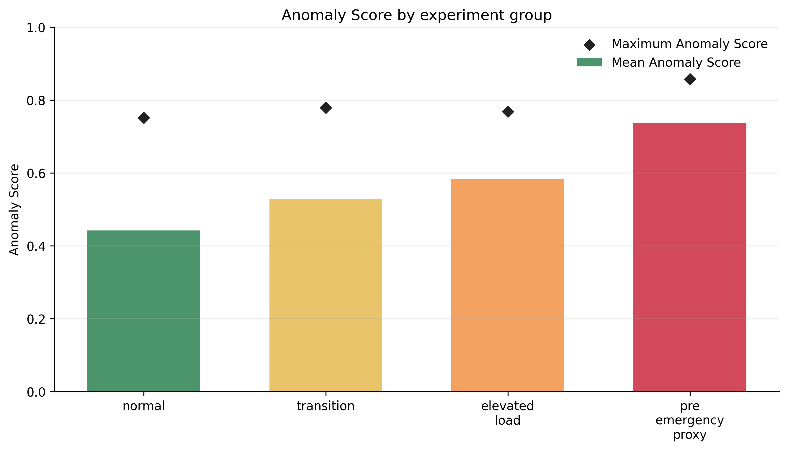
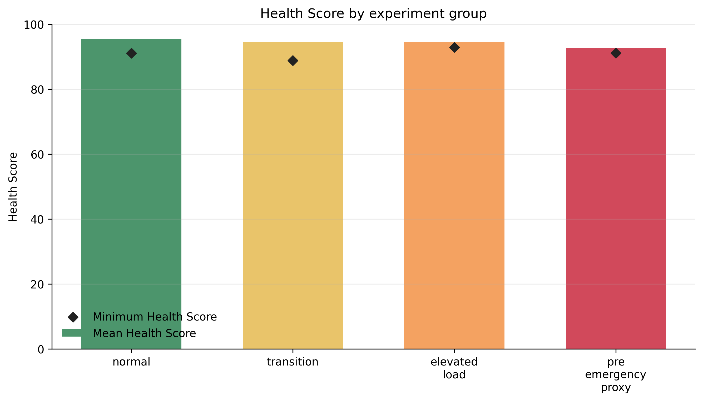
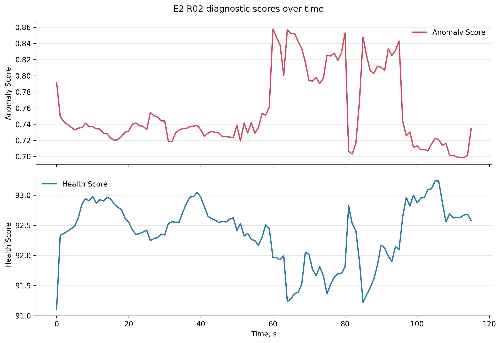
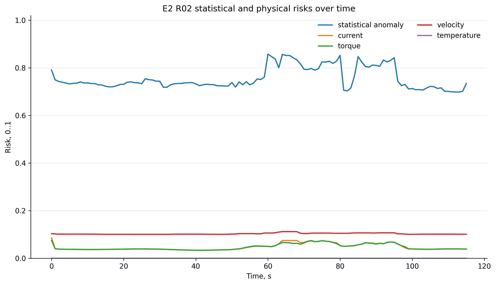
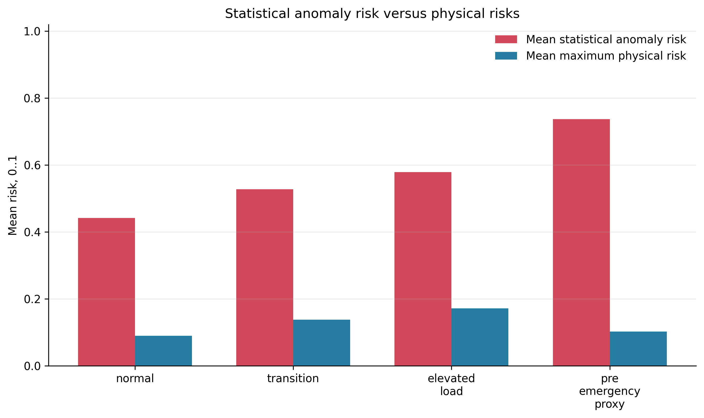
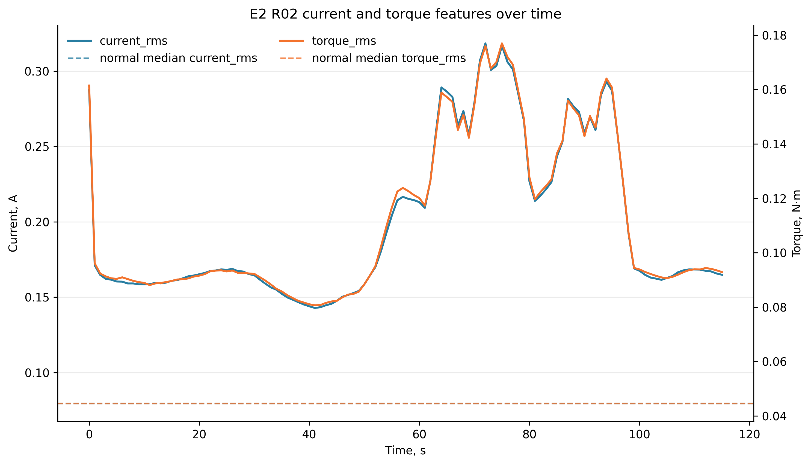

# Article Figures

## Generation command

```powershell
.\.venv\Scripts\python.exe -m servo_diagnostic_model.evaluation.article_plots --summary artifacts/diagnostics/lab_diagnostic_summary.csv --results artifacts/diagnostics/lab_diagnostic_results.json --analysis artifacts/diagnostics/lab_pipeline_analysis.md --normal-manifest data/lab/manifests/normal_profile_files.csv --normal-profile artifacts/profiles/normal_profile_lab.json --limits servo_diagnostic_model/config/limits.json --weights servo_diagnostic_model/config/weights.json --thresholds servo_diagnostic_model/config/thresholds.json --output-dir artifacts/article_figures
```

## Input artifacts

- `artifacts/diagnostics/temperature_risk_fix_diagnostic_summary.csv`
- `artifacts/diagnostics/temperature_risk_fix_diagnostic_results.json`
- `artifacts/diagnostics/temperature_risk_fix_comparison.md`
- `data/lab/manifests/normal_profile_files.csv`
- `artifacts/profiles/normal_profile_lab.json`

## Figures

### fig1_group_anomaly_with_normal

Group anomaly comparison including normal operation.



### fig2_group_health_with_normal

Group Health Score comparison including normal operation.



### fig3_e2_r02_scores_over_time

E2 R02 Anomaly Score and Health Score over time.



### fig4_e2_r02_risks_over_time

E2 R02 statistical and physical risks over time.



### fig5_statistical_vs_physical_risks

Group-level statistical versus physical risk comparison.



### fig6_e2_r02_current_torque

E2 R02 current and torque features over time.



## Normal references

Normal minimum Health Score and mean maximum physical risk were computed from 17 manifest files without retraining the profile.
Figure 6 includes normal-profile median reference lines for current_rms and torque_rms.
